<div align="center">


# 言叶 · ことのは

**英语与日语，按遗忘曲线留下。**

托福 · 雅思 · 四六级 · JLPT N5–N1 · 五十音 —— 一个安静、好看、离线可用的背词 App。

[](https://github.com/Runa-Asahi/kotonoha/releases/latest)
[](https://github.com/Runa-Asahi/kotonoha/releases/latest/download/kotonoha-v2.3.0.apk)
[](https://runa-asahi.github.io/kotonoha/)
[](https://github.com/open-spaced-repetition/ts-fsrs)
[](https://react.dev)

<br/>

<a href="https://github.com/Runa-Asahi/kotonoha/releases/latest/download/kotonoha-v2.3.0.apk"></a>
&nbsp;
<a href="https://runa-asahi.github.io/kotonoha/"></a>

<br/><br/>

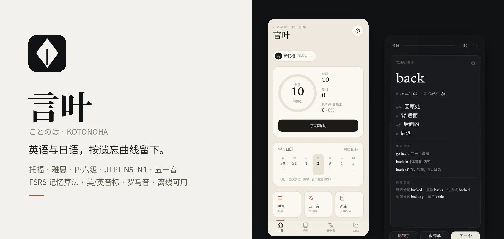

</div>

## ✦ 为什么是言叶

- **记得住**：用 [FSRS](https://github.com/open-spaced-repetition/ts-fsrs)（Anki 也在用的新一代算法）安排复习。每个词按你自己的记忆情况，在快要忘的时候再出现。
- **读得准**：每个英语词都有 **美式 / 英式音标**，两种口音都能播放；每个日语词都有 **假名 + 罗马音**。
- **听得到**：优先播放有道词典的真人发音，没网时用系统语音；**五十音 104 个音全部内置录音**，飞行模式下也能练听音。
- **看得舒服**：两套主题——**和紙**（米色纸纹）和 **墨**（深色），强调色随季节变化（春桜 / 夏青竹 / 秋紅葉 / 冬藍）；标题用明朝体，动画顺滑（60fps），Android 上还有轻微震动反馈。
- **用得省事**：打开就是今天的任务。左右滑动卡片，点一下就能看提示和例句，少点几下就能背完。

## ✦ 截图

| | 今日 | 背词 | 五十音 | 单词详情 | 遗忘曲线 |
|---|---|---|---|---|---|
| **和紙** | 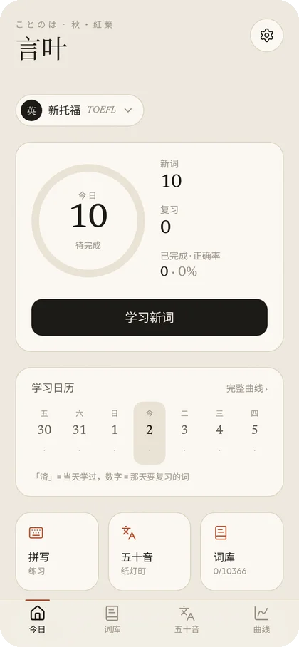 | 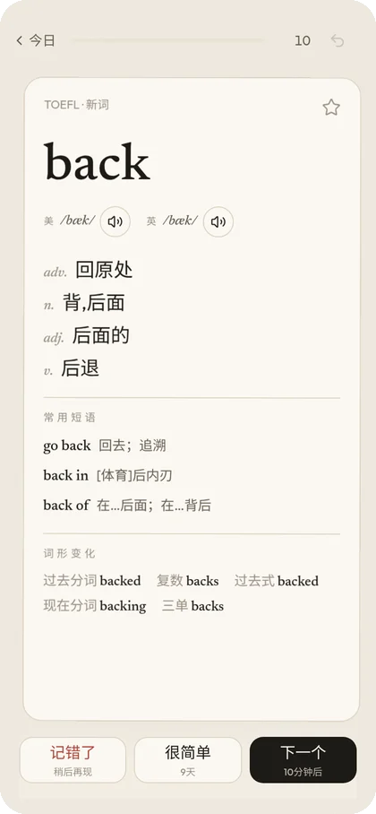 | 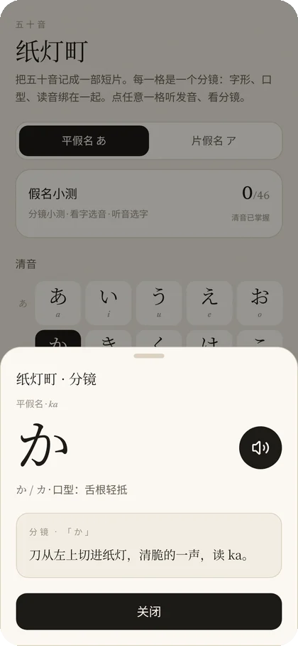 | 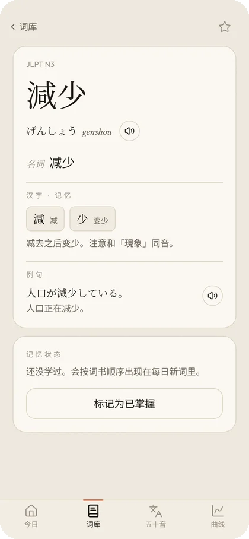 | 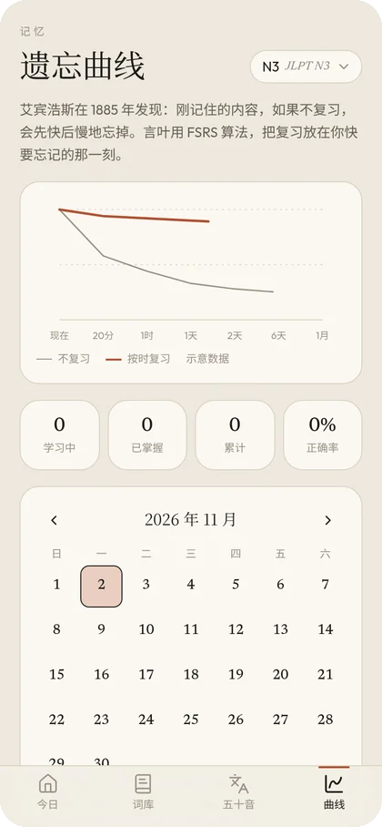 |
| **墨** | 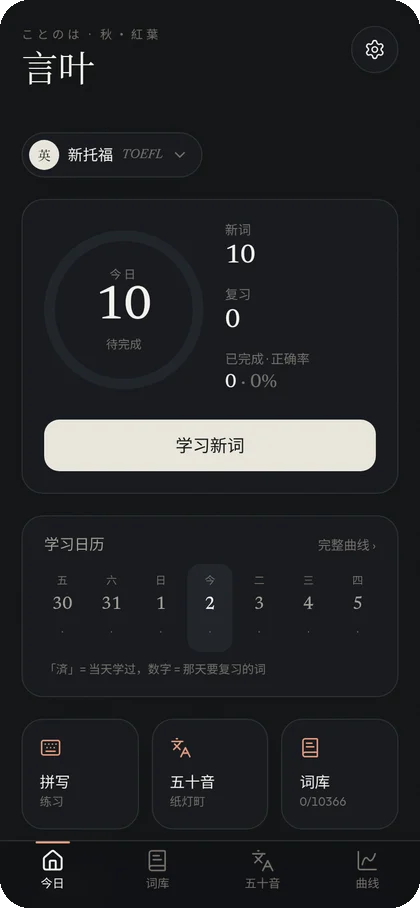 | 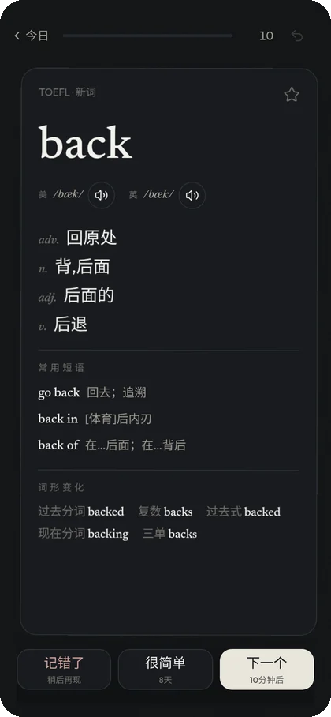 | 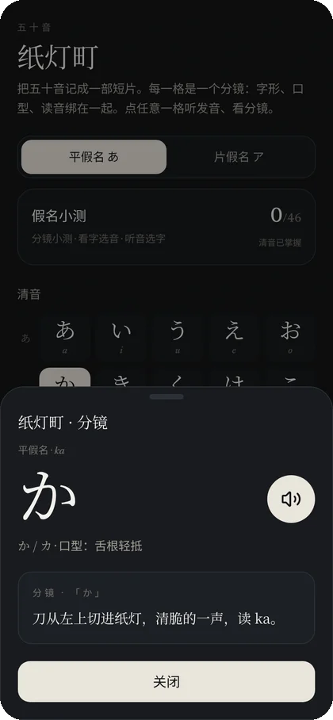 | 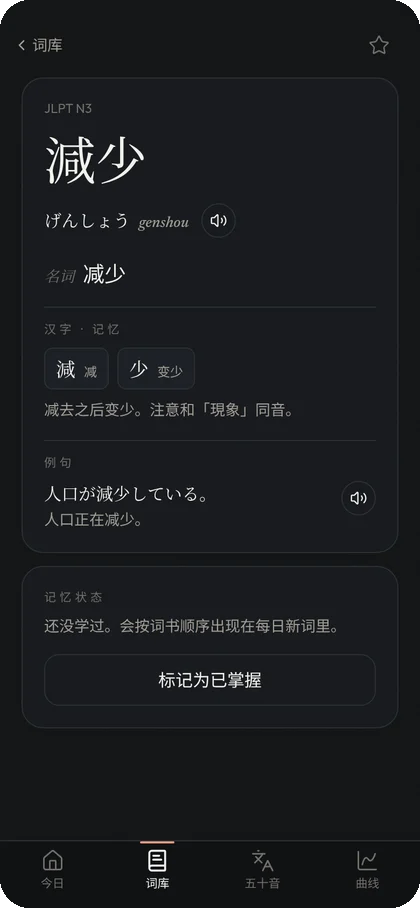 | 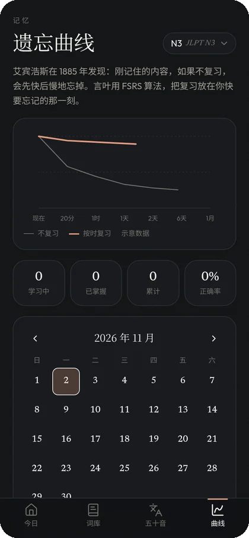 |

<p align="center">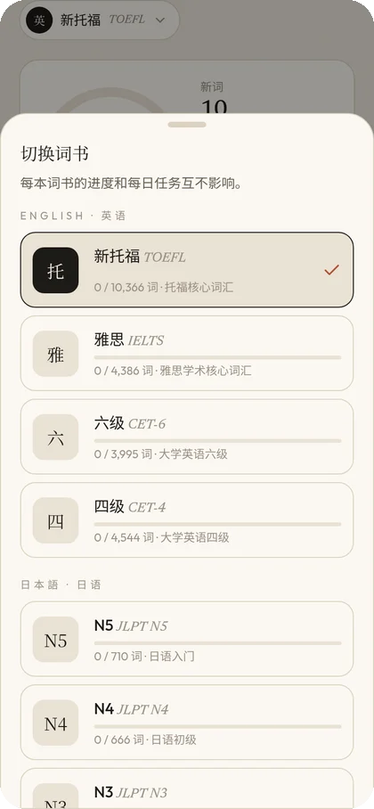&nbsp;&nbsp;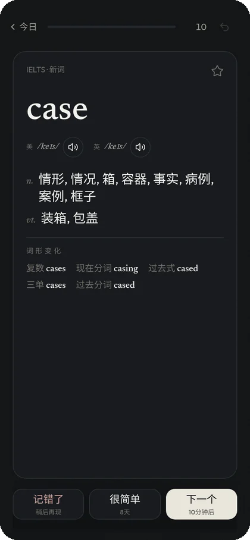</p>

## ✦ 功能

**背单词**
- 首页：今日进度环，新词 / 复习 / 正确率一眼看清；本周学习日历，学过的日子盖「済」章，并标出每天要复习多少词
- 卡片：右滑「认识」、左滑「忘记」；会先给提示（词根、汉字拆解）；可以标「太简单」直接跳过，也能撤销上一步
- 单词详情：释义、例句、常用短语、词形变化、记忆钩子，还有这个词现在大概记得多牢
- 拼写练习，收藏，按状态筛选词库

**五十音 · 纸灯町**
- 平假名 / 片假名、浊音、拗音全表；每个假名有一个「纸灯町」小故事，还有口型和发音说明
- 三种小测：分镜小测（会记最高分，答对自动下一题）、看字选音、听音选字；经常答错的假名会多出现

**遗忘曲线**
- 遗忘曲线动画、月度复习日历、未来 7 天要复习多少词、每本词书的进度

**其他**
- 每本词书的进度和每日任务都分开算，换词书不会打乱进度
- 支持 PWA，装到桌面后可以完全离线使用；也可以直接装 Android APK

## ✦ 词书

| 词书 | 语言 | 词数 | 音标 / 读音覆盖 | 来源 |
|---|---|---:|---|---|
| 新托福 TOEFL | 英语 | 10,366 | 美/英音标 99.3% | KyleBing/english-vocabulary |
| 雅思 IELTS | 英语 | 4,386 | 美/英音标 99.8% | ECDICT（标记为 ielts 的词，按词频排序） |
| 六级 CET-6 | 英语 | 3,995 | 美/英音标 99.97% | KyleBing/english-vocabulary |
| 四级 CET-4 | 英语 | 4,544 | 美/英音标 99.9% | KyleBing/english-vocabulary |
| JLPT N5 | 日语 | 710 | 假名 + 罗马音 100% | open-anki-jlpt-decks |
| JLPT N4 | 日语 | 666 | 假名 + 罗马音 100% | open-anki-jlpt-decks |
| JLPT N3 | 日语 | 2,111 | 假名 + 罗马音 100% | open-anki-jlpt-decks |
| JLPT N2 | 日语 | 1,912 | 假名 + 罗马音 100% | open-anki-jlpt-decks |
| JLPT N1 | 日语 | 2,700 | 假名 + 罗马音 100% | open-anki-jlpt-decks |
| 五十音 | 日语 | 104 音 | 内置录音（语音合成） | 自制（edge-tts 生成） |

## ✦ 下载与安装

- **Android**：从 [最新版本](https://github.com/Runa-Asahi/kotonoha/releases/latest) 下载 `kotonoha-v2.3.0.apk`，允许「安装未知来源应用」后安装。如果提示签名冲突，先卸载旧版本再装。
- **网页 / iPhone**：打开 <https://runa-asahi.github.io/kotonoha/>，在浏览器菜单里选「添加到主屏幕」，之后就能离线使用。
- **自己部署**：下载 `kotonoha-v2.3.0-web.zip`，解压后放到任何静态网站服务器上就能用。

学习记录只保存在你自己的设备里（浏览器本地存储），不需要注册账号。

## ✦ 本地开发

```bash
git clone https://github.com/Runa-Asahi/kotonoha.git && cd kotonoha
npm install
npm run dev          # http://localhost:5173
npm run lint && npm test && npm run build

# 重新生成词书（会下载源数据；可以把缓存目录作为参数传入）
node scripts/build-words.mjs

# Android
npx cap sync android && cd android && ./gradlew assembleDebug
```

## ✦ 技术栈

Vite 8 · React 19 · TypeScript · Tailwind CSS 4 · [ts-fsrs](https://github.com/open-spaced-repetition/ts-fsrs) 6 · Zustand · Wouter · Motion · vite-plugin-pwa (Workbox) · Capacitor 8 · wanakana · Vitest · GitHub Actions（自动部署 Pages、自动打包 APK）

## ✦ 致谢与许可

- 英语词表：[KyleBing/english-vocabulary](https://github.com/KyleBing/english-vocabulary)（BSD-3-Clause）
- 雅思词表、英式音标、词形变化：[ECDICT](https://github.com/skywind3000/ECDICT)（MIT）
- 美式音标：[CMU Pronouncing Dictionary](https://github.com/cmusphinx/cmudict)（BSD 风格许可），由 ARPAbet 转换为 IPA
- 日语词表：[jamsinclair/open-anki-jlpt-decks](https://github.com/jamsinclair/open-anki-jlpt-decks)（MIT），数据源自 Jonathan Waller 的 [tanos.co.uk](http://www.tanos.co.uk)（CC BY）
- 罗马音：[WanaKana](https://github.com/WaniKani/WanaKana)（MIT）
- 字体：Noto Serif CJK JP 子集、Newsreader、Outfit（SIL OFL 1.1）
- 五十音录音：用 edge-tts（ja-JP-NanamiNeural）生成；单词在线发音来自有道词典，运行时在线获取，不随应用分发

完整的许可证文本见 [`public/words/LICENSE`](public/words/LICENSE)。
